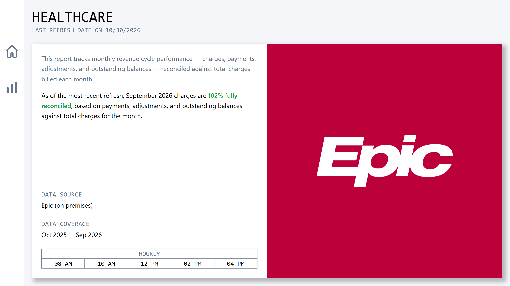
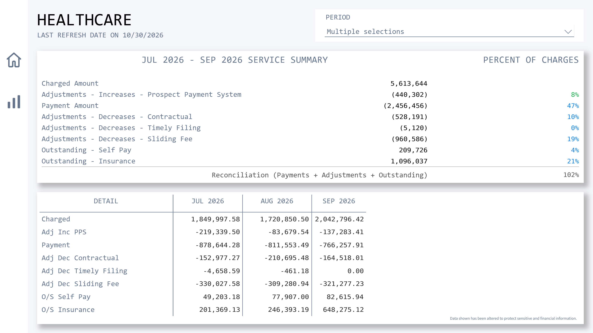
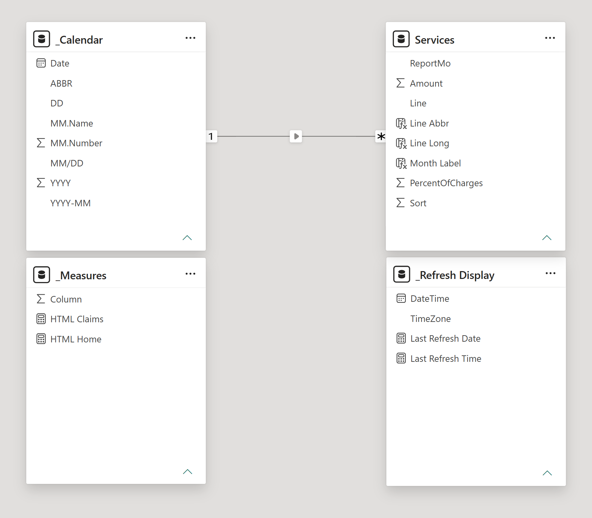

# Healthcare Claims Dashboard

A monthly revenue cycle report built for a Finance team, replacing a summary report they previously pulled from Epic by hand. It tracks charges, payments, adjustments, and outstanding balances for any period, and checks that everything reconciles back to total charges so leadership can trust the numbers.

## What it shows

- Charges, payments, adjustments, and outstanding balances
- Each line as a percent of total charges, with a reconciliation check
- A month-by-month detail table for any period selected

**Data source:** Epic (on-premises SQL Server)
**Built with:** Power BI, DAX, SQL Server, Canva

Built on my [Power BI Report Template](https://github.com/franklinbusi/report-template).

*Data shown has been altered to protect sensitive and financial information.*
